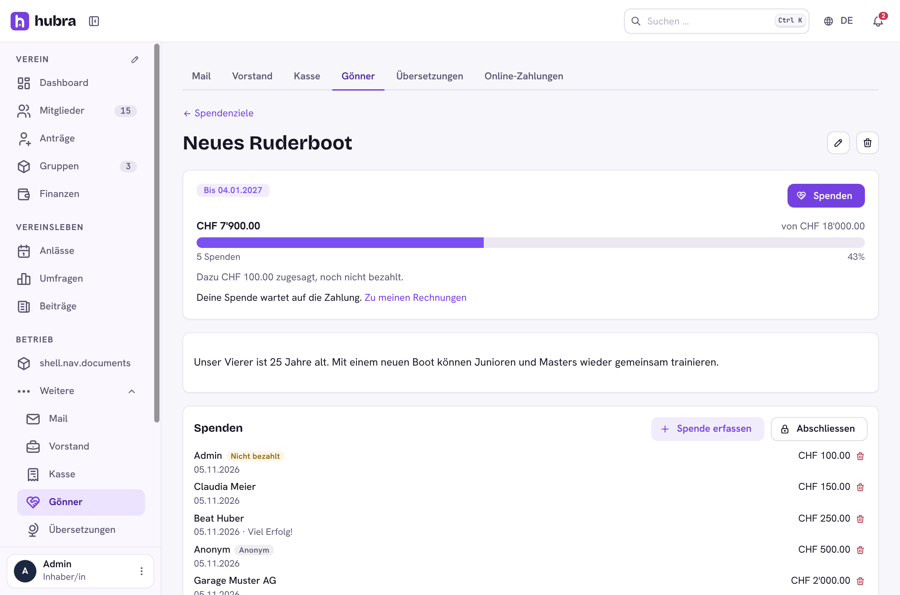

# Supporters

[](https://github.com/hubra-app/hubra-plugin-supporters/actions/workflows/release.yml?query=branch%3Amain) [](https://github.com/hubra-app/hubra-plugin-supporters/releases/latest) [](LICENSE)

A plugin for [Hubra](https://hubra.club). Sponsors and fundraising: sponsor packages, yearly sponsor invoices and logos for the club website, and fundraising goals with a progress bar, recorded donations and member pledges.

**Version** 1.0.0 · **Works with** Hubra >=0.2,<1 · **Plugin id** `supporters` · **Needs** the members and finance modules, and Hubra's file store for logos



## What it does

| Page | |
| --- | --- |
| Spendenziele | A goal with a target amount, an optional end date and a finance category. The treasurer records donations (each books an income in Finanzen). Members pledge an amount: that creates an invoice to themselves, and the pledge counts once the invoice is paid. Donors can stay anonymous to other members. |
| Sponsoren (in Finanzen, `/app/finance/sponsors`) | Sponsors with contact, address, a package (Gold, Silber …) or their own amount, a term and a logo. "Rechnungen erstellen" invoices every sponsor active in a year once, as an external party, so pressing it twice invoices nobody twice. |

The club website can read shown sponsors (with logos) and open public goals
without signing in, from `/api/v1/app/supporters/public/<club slug>`.

Permissions: `supporters.sponsors.read`, `supporters.sponsors.update`,
`supporters.goals.update`. Every member sees goals and can pledge.

## Install

Platform admins install it from the Plugin catalogue in manage
(official Marketplace, <https://plugins.hubra.club/index.json>, signed with
the Hubra project key). Clubs then switch it on under Einstellungen → Module.

## Develop

Clone this repository into `plugins/supporters` of a Hubra checkout. Its tests
then run with Hubra's (`cd app/backend && pytest ../../plugins/supporters`), and
`npm run build:plugin` in `app/frontend` builds its frontend. The workflow
does the same against Hubra's `main` on every push and pull request.

## Releasing

Bump `version` in `plugin.yaml`, add a `## <version>` section to
`CHANGELOG.md`, commit, then publish a GitHub release tagged `v<version>`
(web UI, or `gh release create v<version> --target main --notes ""`). The
workflow tests the plugin and builds its frontend; a separate job in the
`plugin-signing` environment, the only one with the `HUBRA_SIGNING_KEY`
secret, signs it; then `supporters-<version>.zip` is attached to the release. Files listed in `.releaseignore` stay out of the zip.
`CHANGELOG.md` and merge. Then tag the merged commit on main and push the tag:

```sh
git switch main && git pull
git tag v<version> && git push origin v<version>
```

The workflow tests the plugin and builds its frontend, the `plugin-signing`
job signs it after your approval, and only then is the GitHub release
`v<version>` published, with `<id>-<version>.zip` and its `.sha256` attached. Files
listed in `.releaseignore` stay out of the zip. Releases are immutable, so a
published version never changes: fix a bad one with a new version. The template itself is never signed.

Source: <https://github.com/hubra-app/hubra-plugin-supporters>
